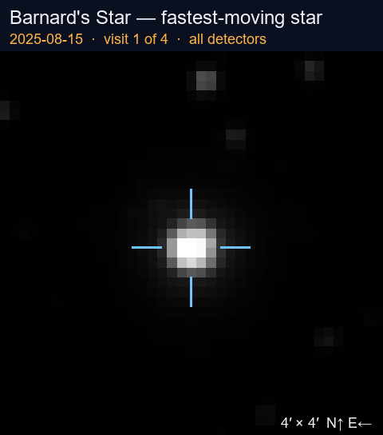
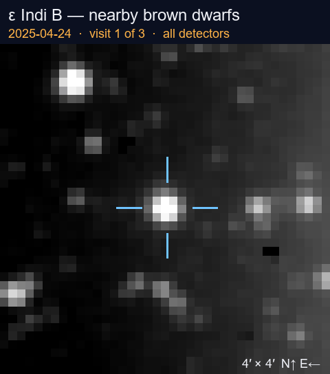
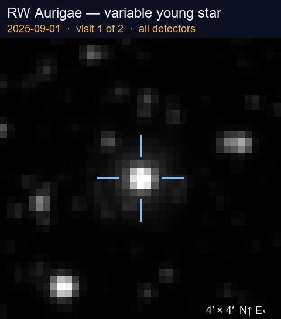

# Radians

**See the infrared sky change.** Radians is a public web tool that turns NASA SPHEREx images of any
patch of sky into a short "blink" movie, so anyone can spot stars, brown dwarfs, asteroids and comets
moving, and variable stars changing brightness.

NASA Space Apps Challenge 2026 — *Planet X and SPHEREx*.

**Live:** https://radians.onrender.com (free instance: it sleeps after 15 quiet minutes and takes about a minute to wake; the five challenge targets are built into the server and open at once, any other position takes 2–5 minutes the first time) ·
**Slides (PDF):** [`docs/Radians-slides.pdf`](docs/Radians-slides.pdf)

<p>
  
  
  
</p>

*Real SPHEREx DR1 frames as Radians blinks them (made by `backend/scripts/make_media.py`).*
Slides: [`frontend/slides.html`](frontend/slides.html) (served at `/static/slides.html`) ·
demo reel: [`docs/media/radians-demo.gif`](docs/media/radians-demo.gif) · recording script: [`docs/demo-script.md`](docs/demo-script.md)

## What the challenge asked for

The challenge asks for a public web tool that shows SPHEREx images of any RA/Dec "like a little video".
Its optional ideas, and where Radians stands:

| Suggestion on the challenge page | Radians |
|---|---|
| Easy to update with new data releases | Yes. Every public SPHEREx release in IRSA is searched (`spherex_qr3` and `spherex_dr1` today; one setting to add the next), and the exposure list is refreshed twice a day. |
| Add each detector's data to improve signal-to-noise; spectra on the fly | Yes. Inverse-variance co-adds per visit (and per visit and detector); a 0.75–5 µm spectrum of any pixel on request. |
| Add or subtract images from different times | Yes. Frame − median, frame − previous, frame − first, and a deep stack. |
| Let users choose the field of view | Yes. 2′ to 20′. |
| Overlay Gaia or WISE | Yes. Gaia DR3 drawn on the image at each frame's date; every candidate is checked against Gaia DR3, SIMBAD and CatWISE2020 (a catalogue that cannot be reached is named as "could not check"); Aladin Lite with AllWISE, 2MASS, CatWISE2020 and SPHEREx maps. |
| Coordinates in the URL, embeddable | Yes. Every view is a link (`?ra=&dec=&fov=&det=&view=…`); `embed=1` hides the page chrome. |
| Contamination flags | Yes. Per-pixel SPHEREx flags shown on demand, summarised per frame, and used to mark doubtful measurements. |
| Public tools (Astropy, Aladin) | Astropy and PyVO throughout; Aladin Lite (CDS) for the wider view. |

Beyond the list: known asteroids from IMCCE SkyBoT, archived NEOSSat images from the Canadian Space
Agency, a candidate report you can copy, CSV export of every measurement, 2×/4× zoom with drag,
animated-GIF download of any view, an injection test of the finder, English and Turkish.

## How it works

1. You type coordinates (`08h55m10.8s -07d14m42s`, `133.795 -7.245`) or a name (`Barnard's Star`).
   Names are resolved with CDS Sesame, which also returns proper motion so fast movers stay centred.
2. The backend asks NASA/IPAC IRSA which SPHEREx exposures cover that position (SIA2).
3. Instead of downloading 65 MB files, it reads only the pixel rows it needs with HTTP byte ranges
   (~30 kB per exposure), including the RICE-compressed contamination flags.
4. Exposures are reprojected onto one grid, background-subtracted, grouped into epochs (SPHEREx
   revisits the sky every ~6 months) and co-added with inverse-variance weights.
5. Every exposure also gives a brightness measurement at a known wavelength (the SPHEREx
   linear-variable filters), which is what makes on-the-fly spectra possible.

New data releases are picked up automatically: the archive is queried live, and adding a release is
one environment variable (`SPHEREX_COLLECTIONS=spherex_dr2,spherex_dr1`).

## Roadmap

| Phase | What | Status |
|---|---|---|
| 0 | Data discovery: IRSA collections, file layout, byte-range access | ✅ |
| 1 | Core backend: search, cutouts, reprojection, epochs, co-add, photometry, API | ✅ |
| 2 | Blink player: input, playback, stretch, dates, shareable URLs | ✅ |
| 3 | Discovery tools: difference/stack views, detector selection, flag summary, candidate finder, EN/TR | ✅ |
| 4 | Extras: on-the-fly spectra, light curves, Gaia DR3 / SkyBoT overlays, NEOSSat archive, Aladin Lite context | ✅ |
| 5 | Testing on challenge targets, deployment (Hugging Face Space), demo | ⏳ |

## Repository layout

```
Radians/
├── backend/                     Python (FastAPI) server: reads public NASA/IPAC IRSA data, serves the API and the site
│   ├── app/
│   │   ├── main.py              app, routes (/api/…), caching headers, rate limits, serves frontend/ at /static and /planet
│   │   ├── archive.py           finds SPHEREx exposures (IRSA SIA2), resolves names (CDS Sesame)
│   │   ├── fitsrange.py         byte-range reads of remote FITS files (only the pixels needed)
│   │   ├── stack.py             reprojection, background subtraction, epochs, co-adds
│   │   ├── detect.py            moving / variable candidate finder
│   │   ├── crossmatch.py        SIMBAD + CatWISE2020 for the candidate cards
│   │   ├── external.py          Gaia DR3, SkyBoT, NEOSSat (CADC) lookups
│   │   ├── explorer.py          planetarium API (/api/sx/…) and the infrared-RGB HiPS tiles (/hips/spherex-color)
│   │   ├── config.py            settings from environment variables (data release, cache, workers)
│   │   └── wave_seed/           pre-computed spectra for the demo targets
│   ├── demo/cache/              cached answers for the five challenge targets (the demo works offline)
│   ├── scripts/                 tools: cache warming (warm.py), demo media, profiling and debugging
│   ├── tests/                   pytest suite
│   └── requirements.txt
├── frontend/                    the website (plain ES modules, no build step)
│   ├── index.html               the single page: Home, Blink viewer, Map, Planetarium sections
│   ├── slides.html              presentation slides (served at /static/slides.html)
│   ├── css/
│   │   └── styles.css           Radians theme (dark/light), layout of every section
│   ├── js/
│   │   ├── core/                shared by every section
│   │   │   ├── i18n.js          English / Turkish texts and the language switch
│   │   │   ├── ui.js            page chrome: landing/viewer switch, light/dark, first-visit guide
│   │   │   ├── palette.js       colour palettes (grey, negative, inferno, viridis, wavelength, infrared RGB)
│   │   │   ├── cube.js          SPHEREx all-sky cube: wavelengths of its 102 planes
│   │   │   └── charts.js        SVG charts (spectra, light curves)
│   │   ├── blink/               the Blink viewer (watch a field change between SPHEREx visits)
│   │   │   ├── app.js           viewer: search, playback, candidates, spectra, sharing
│   │   │   ├── finds.js         plain words for the candidate cards, catalogue check
│   │   │   ├── sky.js           image maths: stretch, stacking, WCS, decoding
│   │   │   ├── depth.js         "sharpening": the image gets cleaner as exposures pile up
│   │   │   └── gif.js           GIF export
│   │   ├── map/
│   │   │   └── map.js           all-sky Map section (Aladin Lite + SPHEREx cube)
│   │   ├── planetarium/
│   │   │   └── planetsec.js     Planetarium section controls (time of night, places, targets)
│   │   └── content/
│   │       ├── facts.js         target facts, glossary, story texts
│   │       ├── about.js         "About this target" panel
│   │       └── funfacts.js      did-you-know cards
│   ├── planet/                  planetarium engine (by Emre Bozkaya), shown inside the Planetarium section
│   │   ├── index.html, css/     engine page (also usable on its own at /planet/)
│   │   ├── js/                  sky renderer (sky.js), HiPS imagery (hips.js), astronomy (astro.js), app.js, tr.js
│   │   └── data/                stars, constellations, Milky Way, deep-sky objects (d3-celestial, BSD-3)
│   ├── media/                   GIFs and screenshots of the challenge targets
│   └── tests/                   node --test suite for the image maths
├── docs/                        validation report, demo script, slides PDF, figures
├── deploy/huggingface/          Dockerfile and card for a Hugging Face Space
├── explore/                     early probes of the IRSA archive (kept for reference)
├── Dockerfile, render.yaml      container and Render.com deployment
└── .github/workflows/           CI: backend and frontend tests
```

## Run locally

```bash
python -m venv .venv && .venv/bin/pip install -r backend/requirements.txt
cd backend && ../.venv/bin/uvicorn app.main:app --reload
# open http://127.0.0.1:8000
```

Tests: `cd backend && python -m pytest -q tests` and `node --test frontend/tests`

Fill the caches for the five demo targets (a few minutes, once): `cd backend && python scripts/warm.py`

## Deploy

The `Dockerfile` runs everything in one container. **Render** (what the live site uses): New → Web
Service → public repository URL, Docker, Free plan, `MAX_WORKERS=16`; or use the `render.yaml` Blueprint.

**Hugging Face** Docker Spaces now need a paid plan. With one, create a Docker Space, then:

```bash
deploy/push_hf.sh <hf-user>/<space-name>
```

The script pushes the current commit with `deploy/huggingface/README.md` as the Space card.
Settings (environment variables): `MAX_WORKERS` (parallel IRSA reads, 32 in the container),
`WARM_ON_START=1` (prepare the demo targets in the background at start-up), `CACHE_DIR`.

**Speed.** A new position needs every SPHEREx exposure that covers it (300–400), about 0.5 MB each over
HTTP byte ranges, most of it the compressed flag rows: 2–5 minutes, on the free Render server too (about
2 minutes measured for Barnard's Star with an empty cache). The page shows how many exposures have been
read. The cache lives in the container, and Render's free plan starts a fresh container on every deploy
and wake-up, so only the five challenge targets, built into the image by `scripts/bake_demo.py`, are
always instant.

**Deploying to Render** does not happen on `git push`: the live service was created by hand, so use
Manual Deploy → Deploy latest commit in the dashboard.

## API

| Endpoint | Purpose |
|---|---|
| `GET /api/resolve?q=Barnard's Star` | name or coordinates → RA/Dec (+ proper motion) |
| `GET /api/observations?ra=&dec=` | SPHEREx exposures covering a position |
| `GET /api/frames?ra=&dec=&fov=300&mode=epoch` | aligned frames (`epoch`, `epoch_detector`, `exposure`) + photometry + candidates |
| `GET /api/progress?job=` | progress of a running `/api/frames?…&job=` request |
| `GET /api/photometry?ra=&dec=&fov=&x=&y=` | per-exposure brightness and wavelength at one pixel: an on-the-fly spectrum |
| `GET /api/gaia?ra=&dec=&radius=` | Gaia DR3 stars (ESA archive), with proper motions |
| `GET /api/crossmatch?ra=&dec=&radius=&cat=` | SIMBAD and CatWISE2020 objects in the field, each with its own `ok` (one being down does not fail the request) |
| `GET /api/sso?ra=&dec=&radius=&mjd=` | known asteroids and comets in the field at each date (IMCCE SkyBoT) |
| `GET /api/neossat?ra=&dec=&radius=` | archived NEOSSat images of the area (CSA, via CADC) |
| `GET /api/sx/images`, `/api/sx/cutout`, `/api/sx/catalog`, `/api/sx/simbad`, `/api/sx/resolve`, `/api/sx/hips-properties` | the planetarium and its time-lapse / spectra tool (see below) |
| `GET /hips/spherex-color/…` | SPHEREx infrared colour sky as a HiPS (B = D1+D2, G = D3+D4, R = D5+D6), used by the map's "Infrared RGB" palette |

### Planetarium

`/planet/` is **SPHEREx Sky Explorer** by team member Emre Bozkaya
([EmreBozkaya127/SPHEREx-Sky-Wiever](https://github.com/EmreBozkaya127/SPHEREx-Sky-Wiever)): a planetarium for
any place and time (Istanbul, now, by default) drawn over the SPHEREx all-sky cube, with survey comparison,
catalogue overlays, and a time-lapse / spectrophotometry tool that works on every SPHEREx exposure of a target.
His Node.js server was ported to Python (`backend/app/explorer.py`); HiPS tiles come straight from IRSA.
Star, constellation and Milky Way data: d3-celestial (BSD-3, see `frontend/planet/data/LICENSE-d3-celestial.txt`).

## Validation

`backend/scripts/inject_validate.py` puts fake objects into the real SPHEREx exposures of the five
challenge fields (Gaussian PSF, σ = 0.62 px, on empty sky), runs the same finder as the app, and counts
what comes back: 40 injections per cell, S/N per visit as the finder measures it (aperture flux over
robust noise, which includes confusion). Details in [docs/VALIDATION.md](docs/VALIDATION.md).

| Injected | S/N 5 | S/N 8 | S/N 12 | S/N 20 | S/N 40 |
|---|---|---|---|---|---|
| Mover, 9″/yr | 0% (0/40) | 50% (20/40) | 85% (34/40) | 100% (40/40) | 100% (40/40) |
| Variable (×3 in one visit) | 12% (5/40) | 80% (32/40) | 90% (36/40) | 88% (35/40) | 85% (34/40) |
| New source (one visit only) | 0% (0/40) | 42% (17/40) | 85% (34/40) | 100% (40/40) | 98% (39/40) |

| Field (nothing injected) | Visits | Candidates besides the target |
|---|---|---|
| Barnard's Star | 5 | 0 |
| eps Indi B | 4 | 0 |
| WISE J085510.83-071442.5 | 4 | 0 |
| RW Aur | 3 | 0 |
| R Dra | 3 | 0 |

With nothing injected, the finder reports no candidate besides the target in any of the five fields.
S/N 5 is below the finder's detection threshold (8) on purpose.

## Sharing one free server

Each visitor may ask for 20 views and 90 spectra a minute (HTTP 429 with `Retry-After` beyond that);
at most two new positions are read from IRSA at the same time; IRSA's own `Retry-After` is honoured;
the cut-out cache is trimmed to 4 GB, oldest first. All four are environment settings
(`RATE_FRAMES`, `RATE_PHOT`, `MAX_COLD_BUILDS`, `CACHE_MAX_MB`).

## Limitations

- SPHEREx pixels are 6.15″: motions below about 1″ a year do not show between visits a year apart.
- Saturated stars have no usable core. Their brightness comes from the PSF wings (relative only), and
  motion measured on them depends on the unsaturated wings.
- Visits are compared only at wavelengths every visit sampled (wavelength matching, on by default).
  When visits share few wavelengths, fewer exposures go into each co-add and the comparison is noisier;
  when two visits share no detector at all, matching falls back to each detector on its own.
- Completeness falls off below S/N 8 to 12 per visit (see Validation); a source fainter than that in
  every visit will not be reported.
- Asteroids move within a visit and blur in the co-adds; SkyBoT marks the known ones per exposure.
- It cannot prove a Planet X: a planet hundreds of AU away moves by arcminutes between visits (mostly
  parallax), so it shows as a spot that is "new" in one visit and "gone" in another, not as one mover.
  The transient finder lists such spots; following them up is for telescopes.
- "Not in Gaia DR3" means no Gaia star brighter than G = 19 within 7″. Infrared-only objects such as
  WISE 0855 are never in Gaia: check CatWISE2020 in the context view before calling anything new.
- A position nobody has looked at yet takes 2–5 minutes on the free server (all exposures are read
  once), and again after the server restarts; only the five challenge targets are built in.

## Use of AI

Radians was written during the hackathon weekend (from 14 November 2026) with an AI coding
assistant, Anthropic's Claude, under the team's direction: it wrote much of the code, tests and
documentation, and commits it helped write carry a `Co-Authored-By: Claude` line. Every image in the
app and the slides is real SPHEREx data; nothing shown as data is AI-generated. The results above
were checked against catalogue values.

## Licence

Code and text: MIT ([LICENSE](LICENSE)). Data stay under their providers' terms (see below).

## Team

Mert Metin · Efe Gönderen · Bora Hısım · Emre Bozkaya

## Data and credits

This research has made use of the NASA/IPAC Infrared Science Archive, which is funded by the National
Aeronautics and Space Administration and operated by the California Institute of Technology. This work
has made use of data from the European Space Agency (ESA) mission Gaia (https://www.cosmos.esa.int/gaia),
processed by the Gaia Data Processing and Analysis Consortium (DPAC). This research has made use of the
SIMBAD database and Aladin, operated at CDS, Strasbourg, France, and of IMCCE's SkyBoT service.


- **SPHEREx** spectral images (DR1): NASA/IPAC Infrared Science Archive (IRSA). Photometry follows the
  IRSA SPHEREx tutorial notebooks (annulus background, flag bits, wavelength from the WCS-WAVE table).
- **2MASS, AllWISE, DSS2 and SPHEREx HiPS** sky maps for the Aladin Lite context view: served by IRSA.
- **Gaia DR3**: ESA Gaia archive (TAP). **CatWISE2020**: VizieR. Gaia stars are moved to each frame's
  date with their proper motions, so fast movers line up with the SPHEREx image.
- **Known Solar System objects**: IMCCE SkyBoT.
- **NEOSSat** (Canadian Space Agency) archive search: CADC.
- Name resolution by CDS Sesame (Strasbourg); sky viewer: Aladin Lite (CDS).
- Planetarium, time-lapse / spectra tool and the infrared colour recipe: Emre Bozkaya (SPHEREx Sky Explorer);
  sky data from d3-celestial (Olaf Frohn, BSD-3).
- Built with Astropy, PyVO, NumPy, SciPy and FastAPI; the browser side has no build step or framework.

## Finding things

- **Views** (computed instantly in the browser): images, *frame − median of all* (static sky cancels,
  movers and variables stay), *frame − previous*, *frame − first*, and a deep *stack* of every frame.
- **Detectors**: pick D1–D6 or a preset. Cold brown dwarfs such as WISE 0855 are bright only at
  4–5 µm, so try *D5+D6* with wavelength matching off (the *WISE 0855* button does this).
- **Candidate finder**: every query also runs a simple search that
  - co-adds each visit only at wavelengths every visit sampled (**wavelength matching**: SPHEREx has
    no filters, so without it a colour difference between visits looks like a change),
  - finds sources in each epoch (Gaussian peak fits, which stay unbiased on SPHEREx's undersampled PSF),
  - removes small astrometric offsets between epochs using bright common stars,
  - fits straight-line motion through 3 or more epochs (one outlier epoch may be dropped) → **moving**,
  - compares brightness only within the same detector, and needs two detectors to agree → **variable**,
  - flags sources seen in one epoch and truly absent in the others → **one epoch only**.

  On the challenge targets it recovers Barnard's Star (10.38″/yr, PA 354°; catalogue 10.39″/yr, 356°),
  ε Indi B (4.65″/yr, PA 125°; catalogue 4.68″/yr, 123°), WISE 0855 with D5+D6 (8.16″/yr, PA 285°;
  catalogue 8.15″/yr, 275°; see [Validation](docs/VALIDATION.md#wise-0855)) and the variability of RW Aurigae (×1.7).
  Candidates are suggestions to check by eye, each with a SIMBAD link.

## Using the viewer

- **Space** play/pause, **← →** step frames, the timeline jumps to an epoch.
- All frames share one brightness scale, so a star that brightens really is brighter.
- Hover the image for RA/Dec, pixel value (MJy/sr) and the SPHEREx contamination flags of that pixel.
- Every view is a URL: `/?q=RW%20Aur&fov=240&frame=1&cmap=heat&view=diff_median&det=4,5,6&lang=tr`. Add `&embed=1` for a
  chrome-free player to put in an `<iframe>`.

## Spectra, light curves and context (phase 4)

- **Spectrum**: SPHEREx's linear-variable filters see every position at a different wavelength in each
  exposure, so the brightness of one pixel across all exposures *is* a 0.75–5 µm spectrum. The target's
  spectrum appears below the player; click any star to measure it instead. Colours mark epochs.
- **Light curve**: each detector divided by its own median; real variability moves all detectors together.
- **Saturated stars** (Barnard's Star, R Dra) switch automatically to *PSF wings* photometry: the flux in a
  ring 2.5–4.5 px from the core, which still follows the star's brightness.
- **Overlays**: Gaia DR3 circles (propagated to the frame date; a line shows 5 years of motion for stars
  faster than 0.15″/yr) and SkyBoT crosses for known asteroids at that exact time.
- **NEOSSat**: links to archived images of the field from Canada's asteroid-hunting microsatellite.
- **Wider context**: Aladin Lite with 2MASS / AllWISE / SPHEREx / DSS2 maps, the Radians field outlined.
